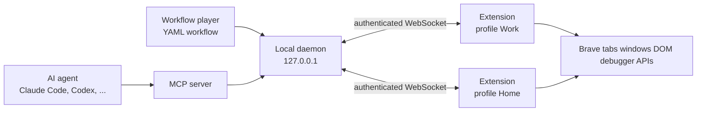

# brave-mcp


[](https://github.com/povesma/embo)

`brave-mcp` controls your own Brave browser on your own machine, in two ways:

- **For AI agents, through MCP.** An agent calls named, typed tools such as `open_tab`,
  `click` or `capture_screenshot` through [MCP](https://modelcontextprotocol.io) (Model
  Context Protocol, the standard way an agent calls external tools). Any MCP-compatible
  agent can use it, for example Claude Code or Codex.
- **Deterministic workflows from the command line.** A workflow player
  (`brave-mcp-play`) runs a YAML workflow of browser steps and local commands the same
  way every time, with branches, retries, pause and resume, and exit codes for
  schedulers and pipelines. An AI agent is the best tool to write the workflow; running
  it needs no agent.

Both drive the same browser through the same local daemon. The browser stays visible,
everything runs locally, and one daemon serves several Brave profiles at once.

## Contents

- [What You Can Do With It](#what-you-can-do-with-it)
- [How It Works](#how-it-works)
- [Quick Start](#quick-start)
- [Check That It Works](#check-that-it-works)
- [Tools](#tools)
- [Workflows From The Command Line](#workflows-from-the-command-line)
- [Security Model](#security-model)
- [Project Status](#project-status)
- [Repository Layout](#repository-layout)
- [Contributing](#contributing)
- [More Documentation](#more-documentation)

## What You Can Do With It

With `brave-mcp`, your AI agent can:

- list, open, switch and close tabs and windows
- navigate pages and wait for them to load
- read page structure and visible text
- click, type, scroll, drag, upload files and press keys
- capture screenshots, PDFs, console logs, cookies and network traces
- change the user agent and media settings of a page
- intercept requests, return mock responses, slow the network down and export session
  state
- choose which Brave profile each action runs in

Without an agent, a workflow file can:

- open or adopt tabs, navigate, reload, wait for elements, type, click and press keys
- run local commands and use their output, such as a password or a one-time code, in
  later steps, without printing or storing it
- start a command in the background, take a URL from its output, and wait for it to end
- retry a step, try alternative selectors, skip ahead when an element is already there,
  and jump between branches
- pause when a step gets stuck, let you correct the file, and resume where it stopped
- run in a chosen Brave profile, and end with an exit code that says what happened

## How It Works

Four parts work together:

| Part | What it is | What it does |
|---|---|---|
| **Extension** | A browser extension loaded into each Brave profile you want to control | The only part that touches the browser and the pages |
| **Daemon** | A small program on your machine, reachable at `127.0.0.1` only | Checks the pairing secret and routes each request to the right profile's extension |
| **MCP server** | The program your agent starts | Offers the tools to the agent and checks their inputs |
| **Workflow player** | A command-line program (`apps/harness`) | Plays a YAML workflow through the daemon, without an agent |



One tool call travels like this:

1. The agent calls a tool such as `open_tab`, `query_selector` or `capture_screenshot`.
2. The MCP server checks the input and sends the request to the daemon.
3. The daemon passes it to the paired Brave extension.
4. The extension performs the action in the browser and returns a typed result.

The parts are separate on purpose: the tool list the agent sees stays stable, while all
browser-specific code stays in the extension and the daemon.

### Several Brave Profiles

One daemon serves every Brave profile that has the extension installed. Each profile has
a nickname, set on the extension's options page.

- With one profile connected, every action runs there.
- With several connected, the agent names the profile with the `profile` input that every
  browser tool accepts; `list_profiles` shows the connected nicknames. An action without a
  name then fails and lists them; nothing is remembered between actions.
- A tab or window number is looked up only in the named profile.
- A workflow run chooses its profile with `--profile` or `BRAVE_MCP_PROFILE` (see
  [Workflows From The Command Line](#workflows-from-the-command-line)).

An agent registration can also carry two settings, as environment variables of the MCP
server:

| Variable | Effect |
|---|---|
| `BRAVE_MCP_PROFILE=<nickname>` | **Default profile.** A tool call without a `profile` runs in this profile, even when several are connected. The agent can still name another profile. If this profile is not connected, calls fail with "Profile … is offline"; they never fall back to another profile. |
| `BRAVE_MCP_PROFILE_LOCK=1` | **Lock** (`1` or `true`). The registration works in the default profile only: a call naming another profile is refused before it reaches the daemon, `list_profiles` shows only the default profile, and no message names another profile. Needs `BRAVE_MCP_PROFILE`; without it the server does not start. |

Set them with `-e` when you register the server, for example to keep one project's agent
in the `Work` profile:

```sh
claude mcp add -s project brave-mcp -e BRAVE_MCP_PROFILE=Work -e BRAVE_MCP_PROFILE_LOCK=1 -- node /absolute/path/to/apps/mcp/dist/index.js
```

They are read only from the environment; arguments after `node …/index.js` are ignored.
The lock prevents mistakes by the agent. It is **not a security boundary**: any program
that can read the pairing secret can call the daemon directly and reach every connected
profile. More in [apps/mcp/README.md](apps/mcp/README.md).

<details>
<summary>Example request and result</summary>

Request sent to the daemon:

```json
{
  "id": "req_123",
  "method": "tabs.navigate",
  "params": {
    "tabId": 401,
    "url": "https://example.com",
    "waitUntil": "load",
    "timeoutMs": 15000
  },
  "authToken": "redacted"
}
```

Result:

```json
{
  "id": "req_123",
  "ok": true,
  "result": {
    "url": "https://example.com/",
    "status": "ok"
  }
}
```

</details>

More detail: [docs/architecture.md](docs/architecture.md).

## Quick Start

### Before You Begin

You need:

- Node `22` or newer
- npm or pnpm
- the Brave browser
- an MCP-compatible agent, such as Claude Code or Codex

### Option A: The Installer

The installer builds everything, creates the daemon config, starts the daemon, opens
`brave://extensions` for you, and registers the MCP server with Codex:

```sh
./install/brave-mcp-install.sh
```

The installer registers only with Codex so far. With Claude Code or another agent, run
it with `--skip-codex` and register the server yourself (step 5 below).

You then load the extension by hand (step 4 below). Flags and the PowerShell version are
in [install/README.md](install/README.md).

### Option B: Step By Step

**1. Install the dependencies**

```sh
npm install
```

**2. Build all packages**

```sh
npm run build:protocol
npm run build:sdk
npm run build:daemon
npm run build:extension
npm run build:mcp
npm run build:harness
```

**3. Start the daemon**

```sh
node apps/daemon/dist/index.js --port 39200 --config-dir /tmp/brave-mcp-smoke
```

Or let the repository start the local stack for you:

```sh
npm run launch:brave
```

The daemon writes its pairing secret to `/tmp/brave-mcp-smoke/daemon-config.json`.

**4. Load the extension in Brave**

1. Open `brave://extensions`.
2. Turn on `Developer mode`.
3. Click `Load unpacked` and select `apps/extension/dist`.
4. Open the extension's options page and set:
   - daemon URL: `ws://127.0.0.1:39200/extension/connect`
   - auth token: the `secret` value from `daemon-config.json`
   - profile nickname: a short name for this Brave profile, such as `Work`
     (1-32 letters, digits, spaces, `-`, `_` or `.`, starting with a letter
     or digit). Agents and their AI provider see it, so it should not reveal
     anything private. The extension does not connect without it.
5. If it does not connect, click `Reconnect Now`.
6. To use more Brave profiles, repeat these steps in each one, with a
   different nickname per profile.

**5. Register the MCP server with your agent**

Replace `/absolute/path/to` with the full path of this repository.

Claude Code (`-s user` makes the tools available in every project):

```sh
claude mcp add -s user brave-mcp -e BRAVE_MCP_CONFIG_DIR=/tmp/brave-mcp-smoke -- node /absolute/path/to/apps/mcp/dist/index.js
```

Codex:

```sh
codex mcp add brave-mcp --env BRAVE_MCP_CONFIG_DIR=/tmp/brave-mcp-smoke -- node /absolute/path/to/apps/mcp/dist/index.js
```

Another MCP client: add a `stdio` server that runs
`node /absolute/path/to/apps/mcp/dist/index.js` with the environment variable
`BRAVE_MCP_CONFIG_DIR=/tmp/brave-mcp-smoke`.

Optional: to give the registration a default profile, or lock it to one, add
`-e BRAVE_MCP_PROFILE=<nickname>` and `-e BRAVE_MCP_PROFILE_LOCK=1` (Codex: `--env`). See
[Several Brave Profiles](#several-brave-profiles) for what they do.

**6. Start a new agent session**

The Brave tools appear only in a session started after the registration.

The same flow with a smoke test is in [docs/local-install.md](docs/local-install.md).

## Check That It Works

### Is the daemon connected to the extension?

```sh
curl -s http://127.0.0.1:39200/readyz | jq
```

Everything is ready when the answer looks like this:

```json
{
  "ok": true,
  "ready": true,
  "extensionConnected": true,
  "paired": true,
  "profileCount": 1
}
```

`profileCount` is the number of connected profiles. If it is `0`, check the daemon URL,
the auth token and the profile nickname on the extension's options page; a refused
nickname shows its reason there.

The daemon's local endpoints are `GET /healthz`, `GET /readyz` and `POST /rpc`.

### "The brave-mcp daemon … is too old"

The MCP server and the workflow player refuse a daemon whose `/healthz` reports no
`protocolVersion` or an older one. This happens after an upgrade, when a daemon started
by the previous version is still running. Stop that daemon process. The MCP server
starts the current daemon by itself the next time it starts; the workflow player never
starts one, so start it with step 3 of the Quick Start.

### Do the packages pass their own checks?

```sh
npm run verify:protocol
npm run verify:daemon
npm run verify:mcp
npm run verify:extension
npm run verify:harness
```

| Command | What it checks |
|---|---|
| `verify:protocol` | The schemas and contracts are valid, and the spec files in `specs/` match them |
| `verify:daemon` | Daemon requests and the profile rules (connection, routing, refusals) work against simulated extensions |
| `verify:mcp` | The MCP tools are wired to the daemon, including the `profile` input, default profile and lock |
| `verify:extension` | The extension builds, and its nickname and refusal logic passes its unit tests |
| `verify:harness` | The workflow player (loading, daemon client, commands, playing, pause and resume, profile choice) works against a stand-in daemon |

The project has also been run against a real Brave browser during development.

## Tools

The MCP server offers 48 browser tools, plus `list_profiles`. Every browser tool also
accepts an optional `profile` input (see [Several Brave Profiles](#several-brave-profiles)).

| Group | Tools |
|---|---|
| **Tabs and windows** | `list_tabs`, `list_windows`, `get_active_tab`, `get_tab_info`, `get_window_info`, `open_tab`, `new_window`, `close_tab`, `close_window`, `switch_to_tab`, `focus_tab`, `set_viewport` |
| **Navigation** | `navigate`, `reload_tab`, `back`, `forward`, `wait_for_navigation`, `wait_for_idle` |
| **Reading the page** | `query_selector`, `query_elements`, `wait_for_selector`, `get_visible_text`, `get_dom`, `elements_from_point` |
| **Acting on the page** | `click`, `hover`, `type_text`, `select_option`, `press_key`, `scroll_to`, `drag_and_drop`, `upload_file` |
| **Capture and diagnostics** | `capture_screenshot`, `capture_pdf`, `get_console_logs`, `download_asset`, `execute_javascript`, `network_log`, `cookie_access`, `session_export`, `har_export` |
| **Network and storage** | `request_intercept`, `mock_response`, `throttle_network`, `clear_storage`, `grant_permissions` |
| **Emulation** | `set_user_agent`, `emulate_media` |

`geolocation_override` was built as a prototype and then removed from the tool list,
because it was not reliable enough in Brave.

The exact inputs and outputs of every tool are defined in machine-readable files:

- [Tool catalog](specs/tools/brave-tools.schema.json)
- [Daemon RPC schema](specs/rpc/daemon-rpc.schema.json)

## Workflows From The Command Line

`apps/harness` is a workflow player: it plays a YAML file of browser steps and local
commands through the daemon, with no AI agent involved. The same file gives the same
steps on every run, so it suits repeated jobs such as a sign-in that needs a password and
a one-time code from command-line tools, run by hand, by a scheduler or as a step of a
larger pipeline.

```yaml
name: example-login
precondition:                   # exit 0 means already signed in: nothing runs
  cmd: [check-session]
steps:
  - open_tab: { url: "https://signin.example.com" }
  - run: { cmd: [get-user], capture: user }
  - type: { selector: "#username", text: "${user}" }
  - click: { selector: "#signin" }
  - wait_for:
      selector: "#mfa"
      on_failure:
        selectors: ["input[name=mfaCode]"]
        retry: { times: 2, wait_s: 3 }
        then: pause             # stop here, let me fix the file, then resume
```

```sh
node apps/harness/dist/index.js --profile Work local/example-login.yaml
```

What the player offers:

| Feature | What it does |
|---|---|
| 14 step types | Tabs (`open_tab`, `use_tab`, `close_tab`), pages (`navigate`, `reload`, `wait_for`, `type`, `click`, `press_key`), commands (`run`, `start`, `await`) and branches (`skip_if_found`, `jump`) |
| Captured values | A command's output, or a pattern in a background command's output, becomes a variable for later steps; it is masked in all output and never written to disk |
| Failure handling | Alternative selectors, retries with a wait, then stop or pause |
| Pause and resume | A stuck run keeps its tab and background commands; you correct the file and press Enter (or send `SIGUSR2`); commands whose values the stuck step needs run again |
| Checks before running | The whole file is validated first: unknown steps or fields, unset variables, steps without a target tab, unreachable branches |
| Profile choice | `--profile <nickname>` or `BRAVE_MCP_PROFILE`; the file itself never names a profile |
| Exit codes | 0 completed, 1 a step failed, 2 invalid input, 3 daemon, extension or profile unavailable, 10 already done (precondition) |

Writing a workflow is best done with an AI agent: with the MCP tools it can open the real
page, find working selectors and test each step, then write the file. The finished
workflow runs without the agent.

The full format, the exit codes and the setup of an automation profile are in
[apps/harness/README.md](apps/harness/README.md).

## Security Model

The project is local and explicit about who may do what:

- The daemon listens on `127.0.0.1` only.
- The extension must present a per-user secret, and works only after pairing.
- The MCP server never talks to the browser directly; it talks to the daemon.
- Every tool that changes the browser is a named tool with typed inputs.
- The daemon can report its health and pairing state without revealing browser content.
  Without the pairing secret it shows only how many profiles are connected, never their
  nicknames.

The browser is visible to you and the control channel stays on your machine.

### What This Project Is Not

- a stealth browser automation framework
- a remote cloud browser grid
- a browser exploitation toolkit
- one untyped endpoint that runs arbitrary browser actions

## Project Status

The stack is implemented and works as a local development system.

| | |
|---|---|
| Version | `0.0.1` |
| Tools | 48 browser tools plus `list_profiles` |
| Profiles | one daemon for any number of Brave profiles |
| Daemon transport | localhost HTTP and a WebSocket bridge |
| Agent transport | local MCP server over `stdio` |
| Without an agent | command-line workflow player for YAML workflows |

**Not done yet:**

- A finished public installer. The current installer works from a local copy of this
  repository only.
- Screenshots and release downloads.

**Planned distribution:**

- the extension published for Brave users through the Chrome Web Store
- the daemon and the MCP server shipped as downloadable programs or packages
- an installer that sets up the daemon, opens the extension's store page and registers
  the MCP server with Claude Code, Codex or another agent

**Next tools after `0.0.1`:**

1. `set_timezone`
2. `cpu_throttle`
3. `device_metrics_override`
4. `set_extra_headers`
5. `download_control`

Progress is tracked in the
[tool implementation checklist](docs/tool-implementation-checklist.md).

## Repository Layout

```text
.
├── apps
│   ├── daemon      # localhost bridge and RPC service
│   ├── extension   # Brave-compatible MV3 extension
│   ├── harness     # agent-free player for YAML browser-and-command scripts
│   └── mcp         # MCP server the agent talks to
├── docs
│   ├── implementation-blueprint.md
│   └── tool-implementation-checklist.md
├── install         # installer scripts and packaging notes
├── packages
│   ├── protocol    # shared schemas and contracts
│   └── sdk         # test/simulation helpers
└── specs
    ├── rpc
    └── tools
```

## Contributing

A tool counts as implemented only when all four layers exist:

- protocol schema
- daemon bridge support
- extension runtime support
- MCP exposure

Every tool must also be verified in at least one automated test or one real-browser run
before it is marked complete.

See [CONTRIBUTING.md](CONTRIBUTING.md) for the full guide.

## More Documentation

| Document | Content |
|---|---|
| [docs/local-install.md](docs/local-install.md) | Step-by-step local install and smoke test |
| [docs/architecture.md](docs/architecture.md) | Architecture notes |
| [docs/implementation-blueprint.md](docs/implementation-blueprint.md) | The design document |
| [docs/tool-implementation-checklist.md](docs/tool-implementation-checklist.md) | Delivery checklist and planned tools |
| [install/README.md](install/README.md) | Installer flags and limits |
| [apps/extension/README.md](apps/extension/README.md) | Extension package notes |
| [apps/daemon/README.md](apps/daemon/README.md) | Daemon package notes |
| [apps/mcp/README.md](apps/mcp/README.md) | MCP server package notes |
| [apps/harness/README.md](apps/harness/README.md) | Workflow player guide |
| [packages/protocol/README.md](packages/protocol/README.md) | Shared schemas |
| [packages/sdk/README.md](packages/sdk/README.md) | Test and simulation helpers |
