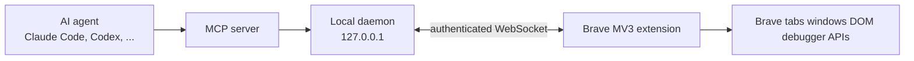

# brave-mcp


[](https://github.com/povesma/embo)

`brave-mcp` lets an AI agent control your own Brave browser on your own machine,
through [MCP](https://modelcontextprotocol.io) (Model Context Protocol, the standard
way an agent calls external tools). Any MCP-compatible agent can use it — for example
Claude Code or Codex — once the server is registered with it.

The browser stays visible, everything runs locally, and each action is a named, typed
tool such as `open_tab`, `click` or `capture_screenshot`.

## Contents

- [What You Can Do With It](#what-you-can-do-with-it)
- [How It Works](#how-it-works)
- [Quick Start](#quick-start)
- [Check That It Works](#check-that-it-works)
- [Tools](#tools)
- [Script Harness: Run Without An Agent](#script-harness-run-without-an-agent)
- [Security Model](#security-model)
- [Project Status](#project-status)
- [Repository Layout](#repository-layout)
- [Contributing](#contributing)
- [More Documentation](#more-documentation)

## What You Can Do With It

With `brave-mcp`, your AI agent can:

- list, open, switch and close tabs and windows
- navigate pages and wait for them to load
- read page structure and visible text
- click, type, scroll, drag, upload files and press keys
- capture screenshots, PDFs, console logs, cookies and network traces
- change the user agent and media settings of a page
- intercept requests, return mock responses, slow the network down and export session
  state

## How It Works

Three parts work together:

| Part | What it is | What it does |
|---|---|---|
| **Extension** | A browser extension loaded into Brave | The only part that touches the browser and the pages |
| **Daemon** | A small program on your machine, reachable at `127.0.0.1` only | Checks the pairing secret and passes requests between the other two parts |
| **MCP server** | The program your agent starts | Offers the tools to the agent and checks their inputs |



One tool call travels like this:

1. The agent calls a tool such as `open_tab`, `query_selector` or `capture_screenshot`.
2. The MCP server checks the input and sends the request to the daemon.
3. The daemon passes it to the paired Brave extension.
4. The extension performs the action in the browser and returns a typed result.

The parts are separate on purpose: the tool list the agent sees stays stable, while all
browser-specific code stays in the extension and the daemon.

<details>
<summary>Example request and result</summary>

Request sent to the daemon:

```json
{
  "id": "req_123",
  "method": "tabs.navigate",
  "params": {
    "tabId": 401,
    "url": "https://example.com",
    "waitUntil": "load",
    "timeoutMs": 15000
  },
  "authToken": "redacted"
}
```

Result:

```json
{
  "id": "req_123",
  "ok": true,
  "result": {
    "url": "https://example.com/",
    "status": "ok"
  }
}
```

</details>

More detail: [docs/architecture.md](docs/architecture.md).

## Quick Start

### Before You Begin

You need:

- Node `22` or newer
- npm or pnpm
- the Brave browser
- an MCP-compatible agent, such as Claude Code or Codex

### Option A: The Installer

The installer builds everything, creates the daemon config, starts the daemon, opens
`brave://extensions` for you, and registers the MCP server with Codex:

```sh
./install/brave-mcp-install.sh
```

The installer registers only with Codex so far. With Claude Code or another agent, run
it with `--skip-codex` and register the server yourself (step 5 below).

You then load the extension by hand (step 4 below). Flags and the PowerShell version are
in [install/README.md](install/README.md).

### Option B: Step By Step

**1. Install the dependencies**

```sh
npm install
```

**2. Build all packages**

```sh
npm run build:protocol
npm run build:sdk
npm run build:daemon
npm run build:extension
npm run build:mcp
npm run build:harness
```

**3. Start the daemon**

```sh
node apps/daemon/dist/index.js --port 39200 --config-dir /tmp/brave-mcp-smoke
```

Or let the repository start the local stack for you:

```sh
npm run launch:brave
```

The daemon writes its pairing secret to `/tmp/brave-mcp-smoke/daemon-config.json`.

**4. Load the extension in Brave**

1. Open `brave://extensions`.
2. Turn on `Developer mode`.
3. Click `Load unpacked` and select `apps/extension/dist`.
4. Open the extension's options page and set:
   - daemon URL: `ws://127.0.0.1:39200/extension/connect`
   - auth token: the `secret` value from `daemon-config.json`
5. If it does not connect, click `Reconnect Now`.

**5. Register the MCP server with your agent**

Replace `/absolute/path/to` with the full path of this repository.

Claude Code (`-s user` makes the tools available in every project):

```sh
claude mcp add -s user brave-mcp -e BRAVE_MCP_CONFIG_DIR=/tmp/brave-mcp-smoke -- node /absolute/path/to/apps/mcp/dist/index.js
```

Codex:

```sh
codex mcp add brave-mcp --env BRAVE_MCP_CONFIG_DIR=/tmp/brave-mcp-smoke -- node /absolute/path/to/apps/mcp/dist/index.js
```

Another MCP client: add a `stdio` server that runs
`node /absolute/path/to/apps/mcp/dist/index.js` with the environment variable
`BRAVE_MCP_CONFIG_DIR=/tmp/brave-mcp-smoke`.

**6. Start a new agent session**

The Brave tools appear only in a session started after the registration.

The same flow with a smoke test is in [docs/local-install.md](docs/local-install.md).

## Check That It Works

### Is the daemon connected to the extension?

```sh
curl -s http://127.0.0.1:39200/readyz | jq
```

Everything is ready when the answer looks like this:

```json
{
  "ok": true,
  "ready": true,
  "extensionConnected": true,
  "paired": true
}
```

If `extensionConnected` or `paired` is `false`, check the daemon URL and the auth token
on the extension's options page.

The daemon's local endpoints are `GET /healthz`, `GET /readyz` and `POST /rpc`.

### Do the packages pass their own checks?

```sh
npm run verify:protocol
npm run verify:daemon
npm run verify:mcp
npm run verify:extension
npm run verify:harness
```

| Command | What it checks |
|---|---|
| `verify:protocol` | The schemas and contracts are valid |
| `verify:daemon` | Daemon requests work against a simulated extension |
| `verify:mcp` | The MCP tools are wired to the daemon |
| `verify:extension` | The extension builds correctly |
| `verify:harness` | The script harness (loading, daemon client, commands, playing, pause and resume) works against a stand-in daemon |

The project has also been run against a real Brave browser during development.

## Tools

Version `0.0.1` offers 48 tools.

| Group | Tools |
|---|---|
| **Tabs and windows** | `list_tabs`, `list_windows`, `get_active_tab`, `get_tab_info`, `get_window_info`, `open_tab`, `new_window`, `close_tab`, `close_window`, `switch_to_tab`, `focus_tab`, `set_viewport` |
| **Navigation** | `navigate`, `reload_tab`, `back`, `forward`, `wait_for_navigation`, `wait_for_idle` |
| **Reading the page** | `query_selector`, `query_elements`, `wait_for_selector`, `get_visible_text`, `get_dom`, `elements_from_point` |
| **Acting on the page** | `click`, `hover`, `type_text`, `select_option`, `press_key`, `scroll_to`, `drag_and_drop`, `upload_file` |
| **Capture and diagnostics** | `capture_screenshot`, `capture_pdf`, `get_console_logs`, `download_asset`, `execute_javascript`, `network_log`, `cookie_access`, `session_export`, `har_export` |
| **Network and storage** | `request_intercept`, `mock_response`, `throttle_network`, `clear_storage`, `grant_permissions` |
| **Emulation** | `set_user_agent`, `emulate_media` |

`geolocation_override` was built as a prototype and then removed from the tool list,
because it was not reliable enough in Brave.

The exact inputs and outputs of every tool are defined in machine-readable files:

- [Tool catalog](specs/tools/brave-tools.schema.json)
- [Daemon RPC schema](specs/rpc/daemon-rpc.schema.json)

## Script Harness: Run Without An Agent

`apps/harness` plays a YAML file of browser steps and local commands through the daemon,
with no AI agent involved. An example is a login that types credentials and a one-time
code fetched from command-line tools.

The script format, exit codes, pause and resume, and the setup of a dedicated browser
profile are described in [apps/harness/README.md](apps/harness/README.md).

## Security Model

The project is local and explicit about who may do what:

- The daemon listens on `127.0.0.1` only.
- The extension must present a per-user secret, and works only after pairing.
- The MCP server never talks to the browser directly; it talks to the daemon.
- Every tool that changes the browser is a named tool with typed inputs.
- The daemon can report its health and pairing state without revealing browser content.

The browser is visible to you and the control channel stays on your machine.

### What This Project Is Not

- a stealth browser automation framework
- a remote cloud browser grid
- a browser exploitation toolkit
- one untyped endpoint that runs arbitrary browser actions

## Project Status

The stack is implemented and works as a local development system.

| | |
|---|---|
| Version | `0.0.1` |
| Tools | 48 |
| Daemon transport | localhost HTTP and a WebSocket bridge |
| Agent transport | local MCP server over `stdio` |

**Not done yet:**

- A finished public installer. The current installer works from a local copy of this
  repository only.
- Screenshots and release downloads.

**Planned distribution:**

- the extension published for Brave users through the Chrome Web Store
- the daemon and the MCP server shipped as downloadable programs or packages
- an installer that sets up the daemon, opens the extension's store page and registers
  the MCP server with Claude Code, Codex or another agent

**Next tools after `0.0.1`:**

1. `set_timezone`
2. `cpu_throttle`
3. `device_metrics_override`
4. `set_extra_headers`
5. `download_control`

Progress is tracked in the
[tool implementation checklist](docs/tool-implementation-checklist.md).

## Repository Layout

```text
.
├── apps
│   ├── daemon      # localhost bridge and RPC service
│   ├── extension   # Brave-compatible MV3 extension
│   ├── harness     # agent-free player for YAML browser-and-command scripts
│   └── mcp         # MCP server the agent talks to
├── docs
│   ├── implementation-blueprint.md
│   └── tool-implementation-checklist.md
├── install         # installer scripts and packaging notes
├── packages
│   ├── protocol    # shared schemas and contracts
│   └── sdk         # test/simulation helpers
└── specs
    ├── rpc
    └── tools
```

## Contributing

A tool counts as implemented only when all four layers exist:

- protocol schema
- daemon bridge support
- extension runtime support
- MCP exposure

Every tool must also be verified in at least one automated test or one real-browser run
before it is marked complete.

See [CONTRIBUTING.md](CONTRIBUTING.md) for the full guide.

## More Documentation

| Document | Content |
|---|---|
| [docs/local-install.md](docs/local-install.md) | Step-by-step local install and smoke test |
| [docs/architecture.md](docs/architecture.md) | Architecture notes |
| [docs/implementation-blueprint.md](docs/implementation-blueprint.md) | The design document |
| [docs/tool-implementation-checklist.md](docs/tool-implementation-checklist.md) | Delivery checklist and planned tools |
| [install/README.md](install/README.md) | Installer flags and limits |
| [apps/extension/README.md](apps/extension/README.md) | Extension package notes |
| [apps/daemon/README.md](apps/daemon/README.md) | Daemon package notes |
| [apps/mcp/README.md](apps/mcp/README.md) | MCP server package notes |
| [apps/harness/README.md](apps/harness/README.md) | Script harness guide |
| [packages/protocol/README.md](packages/protocol/README.md) | Shared schemas |
| [packages/sdk/README.md](packages/sdk/README.md) | Test and simulation helpers |
